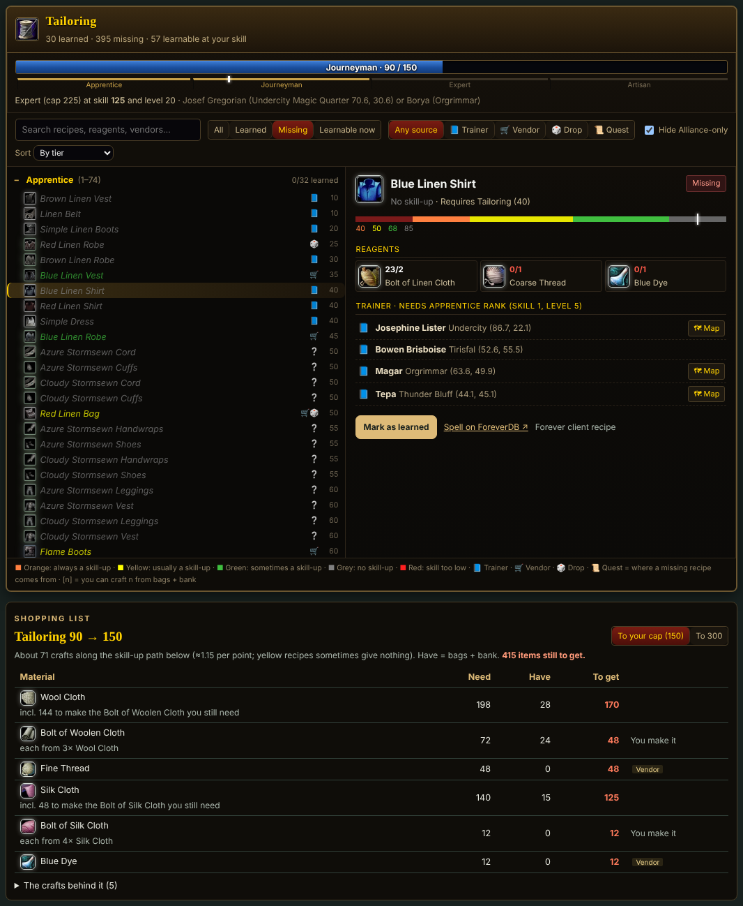
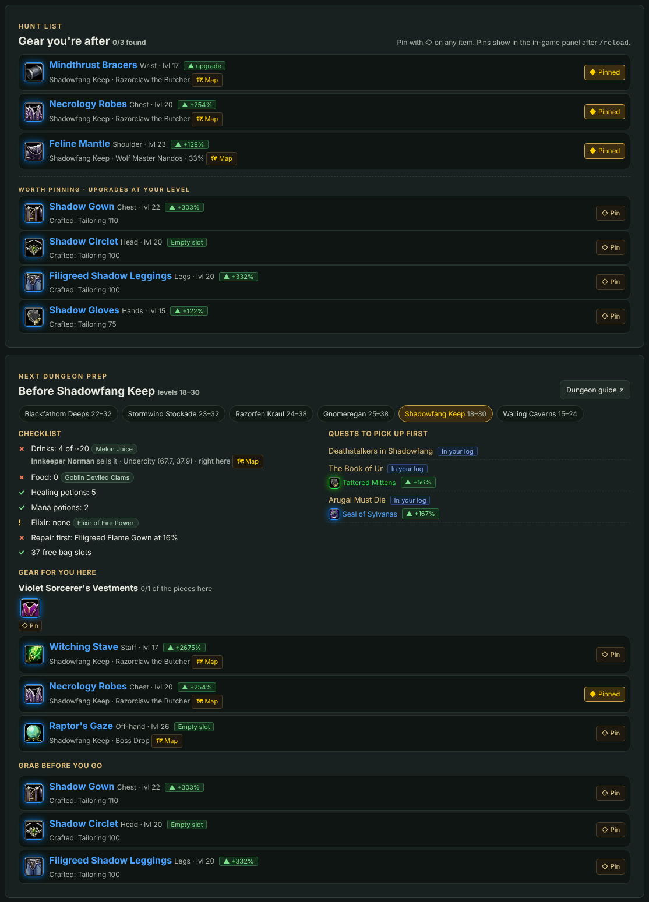
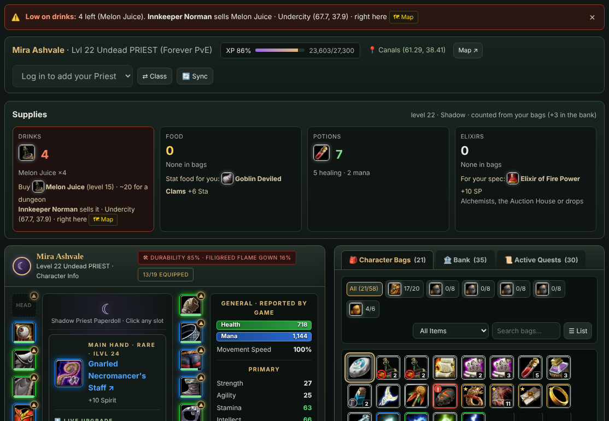
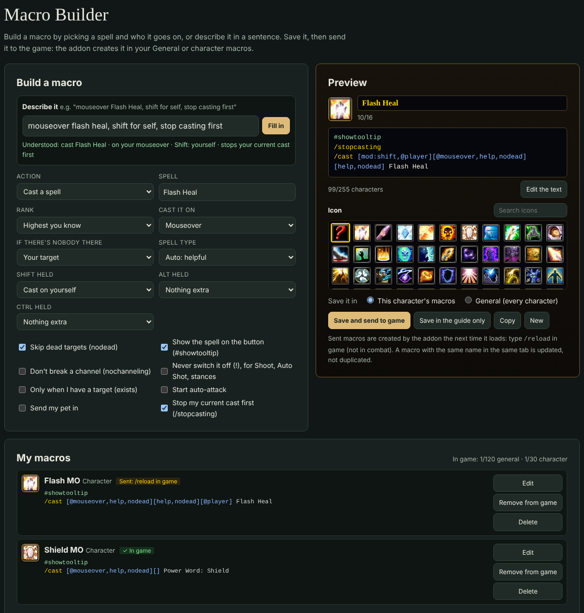

# WoW Forever Guide

Horde leveling guides for **World of Warcraft: Forever**, one per class, levels 1–60, with a live link that keeps the guide in step with the character you're playing. Created by UMJ.

**[Download the latest installer](https://github.com/tshirtwisdom-eng/WoW-Forever-Guide/releases/latest)** (Windows 10/11, `WoW-Forever-Guide-<version>.msi`)

---

## Install

1. Download the `.msi` from [Releases](https://github.com/tshirtwisdom-eng/WoW-Forever-Guide/releases/latest) and run it.
   The installer isn't code-signed yet, so Windows may say *"Windows protected your PC"*: click **More info → Run anyway**.
2. Choose where to install (default: `Documents\WoW Forever Guide`). No admin rights are needed.
3. Check the game folder. Setup looks for WoW Forever on your drives; if it shows the wrong folder, click **Browse** (the standard location is `C:\Program Files (x86)\World of Warcraft`).
4. **Start with Windows** is off unless you tick it.
5. Finish with *Open WoW Forever Guide now* ticked.

**What the installer does:** copies the guides and the app into the folder you chose, adds Start menu and desktop shortcuts, and remembers your game folder. That's all. The app installs the in-game addon the first time it runs, and again after every update so the two always match.

**Uninstall** (Settings › Apps) removes everything: the install folder including your saved characters, the shortcuts, the addon in your game folder, and the startup entry if you turned it on.

## Using the guide

Start **WoW Forever Guide** from the Start menu. It opens the class index in your browser and sits in the tray next to the clock.

- **Log into a character** and its class guide opens by itself. Each character keeps its own progress. A character you haven't played before is added the first time you log in.
- **Leveling route:** each chapter is a list of quest steps. Steps tick themselves off as you complete quests in game, and the next step is always at the top. Quests tagged *Worth it* are especially good; *Skip unless you need the XP* ones can be left out.
- **Character & Inventory:** your gear, bags, bank and stats as the game reports them, with the upgrades worth chasing at your level and the **durability** of every piece. Quest items name their quest, and ones whose quest isn't in your quest log are marked red so you know they're probably safe to delete. Materials your professions use get a small profession icon.
- **Supplies:** a card counts your drinks, food, potions and elixirs and suggests stat food and an elixir for your spec. When you're low on drinks, a red strip at the top of the guide names the **nearest vendor** that sells the right drink for your level, from wherever you are.
- **Quests:** open any quest for where to pick it up, where its mobs and items are on the map, what drops the quest items, who takes it back, and what to do first.
- **Dungeons:** the Prep tab lists every quest for the dungeon (and the ones you need first) with numbered pickup pins; the Bosses tab shows boss portraits on the map, with a gold **!** on bosses that drop something you still need. Click a boss for its drops.
- **Mounts:** riding at 40 and 60 for your race, where to train and buy, and every mount you can collect.
- **Talents & abilities:** the talent calculator matches the in-game trees. Hover a talent to see what it does and, if it gives an ability, its cost, range and cooldown before you spend the point. Below it is your full spellbook (every rank, by level).
- **Macros:** the Macro Builder. Pick a spell and who it goes on, or just describe it (*"mouseover Flash Heal, shift for self, stop casting first"*), then send it straight to the game. See [Macro Builder](#macro-builder) below.
- **Equipment:** pick the spec you're gearing for (or let it follow your talents).
  - **Hunt list:** pin the gear you're after. Each piece shows where it drops, whether you already have it, and how much it beats what you wear. Pins also show in the in-game panel.
  - **Next dungeon prep:** pick a dungeon at your level for a checklist (drinks, food, potions, repairs, bag space), its quests to pick up first, set pieces and the best drops for you, and upgrades to grab before you go.
  - **Dungeon sets and green suffixes:** the set for your level and spec, which pieces you already have and who drops the rest, plus the random green suffixes worth looking for, like *…of the Owl* for casters. Each dungeon's page lists the sets that drop there.
- **Professions:** an in-game style window with your skill bar. Learned and missing recipes are listed together, coloured by difficulty, with where to get each missing one (trainer, vendor with map, drop with chance, quest). A **shopping list** shows every material you need to reach your next cap, against what's in your bags and bank.
- **Maps, flight paths, reputations** are all in the left menu, filtered to your class.
- Offline, a guide opens on the character of that class you played last. Pick another one in the **CHARACTER** box at the top.

| Leveling route | Character & inventory |
|---|---|
|  |  |
| **Professions window and shopping list** | **Hunt list and next dungeon prep** |
|  |  |

## Macro Builder

The **Macros** page builds macros for you and puts them in the game.

- **Pick or describe:** choose a spell (or an item, or a cast sequence) and who it goes on: mouseover, target, focus, target's target, yourself or the cursor, with what to do if nobody's there. Or type what you want, like *"mouseover Renew or me"*, *"wand, don't stop my wand"* or *"corruption then shadow bolt, reset on target"*, and the form fills itself in.
- **Options:** Shift/Alt/Ctrl variants, skip dead targets, `#showtooltip`, stop casting, start auto-attack, pet attack, *never switch it off* (`!Shoot`), *only with a target* (`[exists]`) and *don't break a channel* (`[nochanneling]`). You see the macro as the game will, with the 255-character count.
- **Send to game:** name it, pick an icon (or the question mark so the button shows the spell), choose **General** or **this character**, and click *Save and send to game*. Type `/reload` in game and it's in your macro window, ready to drag to a bar. A macro with the same name is updated, never duplicated, and *Remove from game* deletes it again.
- **Library:** ready-made macros for your class and for every class, checked against the Forever client, each with *Open in builder*.

## The tray app

The book icon next to the clock is the live link. Hover over it to see who's in game. Click it to open the guide. Right-click for:

- **Open characters folder**: one file per character, so you can back them up or delete them.
- **Show log**: what the app is doing, for when something doesn't work.
- **Tablet & phone access…**: opens a page on your PC to turn it on (off by default). Scan the QR code with your tablet or phone and type the 4-digit code shown on the PC; the device then gets the full live guide on your home network. Remove paired devices on the same page. If Windows asks, allow the app on private networks only.
- **Check for updates**
- **Start with Windows**: off unless you turn it on.
- **Quit**

## The in-game addon

**WoW Forever Guide Live Link** (folder `WoWForeverGuide`) is installed for you. It adds a book button on the minimap: click it for the sync window, **Alt+click** to open the guide, right-click for settings (also under *Esc › Options › AddOns*).

Useful commands: `/wfg` (sync window), `/wfg open` (open the guide), `/wfg panel` (in-game panel), `/wfg macros` (set up macros sent from the guide now), `/wfg options`, `/wfg live` (live stream on/off), `/wfg help`.

### The in-game panel (optional)

A small panel in the game with your next quest steps from the class guide and reminders you would otherwise miss: new class spells, a profession rank to train, riding at 40 and 60. It also shows your **supplies** (red when you're low on drinks, with the nearest vendor as a map pin, plus one reminder in chat when you leave town low) and your **hunt list** from the guide. It is **off until you type `/wfg panel`**.

- Each line says what to do and where; quests in progress show the objective and where the mobs or items are.
- **Click** a line to put a pin on your map (TomTom if you have it). **x** skips a quest or dismisses a reminder; `/wfg panel restore` brings them back.
- **Drag** it anywhere (or lock it). The title bar collapses it, opens its settings, or hides it.
- **Settings** (`/wfg panel settings`, or the cog): size, width, text size, background opacity, number of steps, what it shows, hide in combat or in dungeons.

### Why is there a pixel strip?

WoW addons can't send anything out of the game: no internet, no files. Their saved data only reaches the disk when you `/reload` or log out. To keep the guide live anyway, the addon draws a **small coded strip of colored pixels in the bottom-left corner** of the game window. The app reads that strip, and only that 256×10-pixel corner of the WoW window, a few times a second. It carries your position, level and XP, plus your quests, gear, bags, talents and professions, sent in small pieces as they change.

- It hides itself during combat.
- Play in **Windowed** or **Windowed (Fullscreen)** mode, and don't cover the bottom-left corner of the game.
- Don't want it? Type `/wfg live` to turn it off. The guide then updates when you `/reload` or log out.

## Updates

The app checks this page for new releases. When there's one, the guide shows a small dialog with the release notes. Click **Install now** and the app downloads the installer, checks it against the published checksum, installs it, and restarts. The open guide page reloads itself into the new version. **Later** hides the dialog until your next session.

## Good to know

- **Horde only.** Alliance characters are never saved, and the guide will kindly suggest you roll Horde.
- Nothing about your characters is uploaded anywhere. Everything stays in your install folder and your browser.
- The guides work without the app too. Open `WoW Forever Guide.html` in the install folder; you just won't get live updates.
- Game data comes from [ForeverDB](https://foreverdb.net). Fan-made: not affiliated with or endorsed by Blizzard Entertainment. World of Warcraft is a trademark of Blizzard Entertainment.

---

Created by UMJ.
